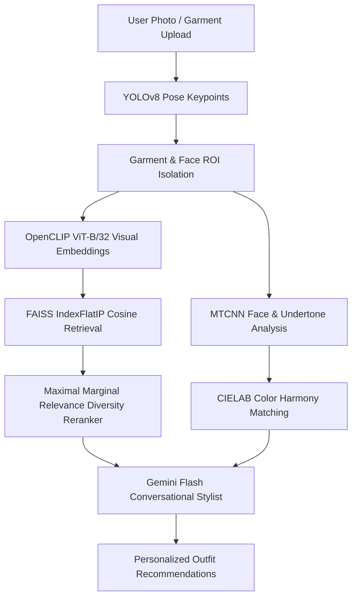

# Atelier (ClothyRec) Multimodal System Architecture

ClothyRec integrates deep visual feature extraction, sub-millisecond vector indexing, and conversational LLM reasoning.

## 1. Core Pipelines

1. **Vision Backbone:** OpenCLIP ViT-B/32 extracting 512-D visual feature vectors.
2. **Vector Index:** FAISS indexing 44,000+ benchmark fashion items with L2 normalization.
3. **Segmentation:** YOLOv8 Pose landmarking isolating upper-body, lower-body, and footwear regions.
4. **Color Engine:** CIELAB $\Delta E$ distance for warm/cool/neutral undertone classification.
5. **Diversity Reranker:** MMR avoiding near-identical garment suggestions.
